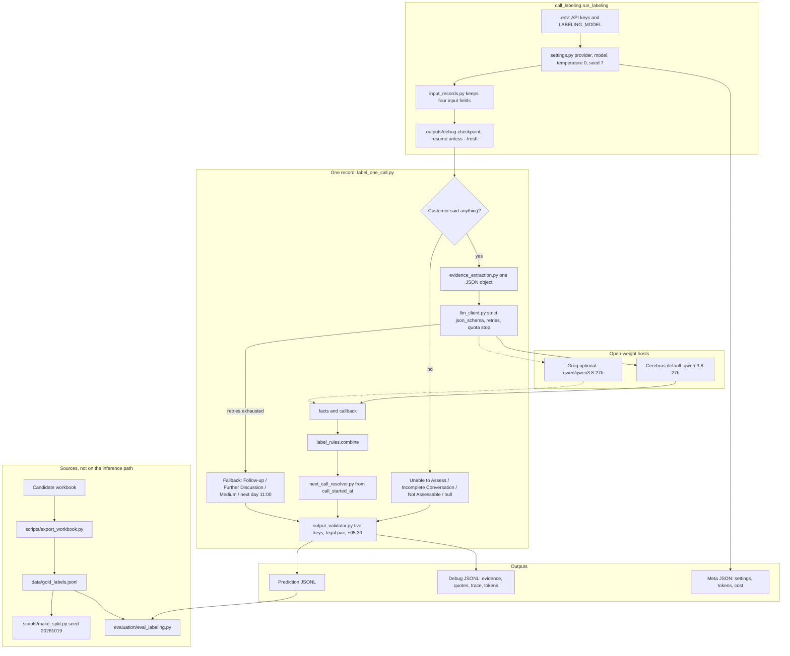
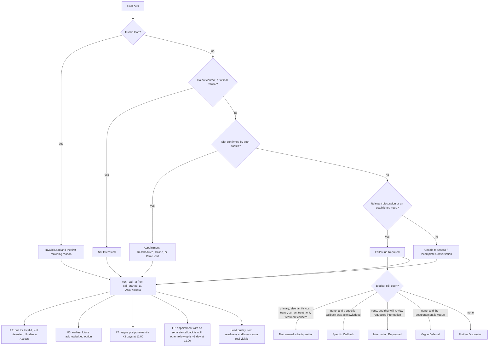

# Task 1 process and high-level design

Label 50 Aster Vale call transcripts. The model reports what happened. Python assigns `disposition`, `sub_disposition`, `lead_quality` and `next_call_at`. Task 2 is a separate package and does not call this model. Its design is in [`task2_process.md`](task2_process.md).

Policy is assignment-v2. Gold labels never enter inference. Prompts are markdown files with no transcript ids and no per-record branches. The `openai` package is only the HTTP client. No closed OpenAI model is called.

## High-level design

One record in, one five-field prediction out. The model never sees the label set as something to fill in, and it never computes a date. A failed record becomes a valid fallback and does not stop the run.

`--provider groq` swaps the host. `--model` overrides `LABELING_MODEL`, which overrides the provider default. `--calls 2` still exists and sends the transcript twice. `--votes N` repeats extraction and keeps a blocker only with a strict majority. Both stay off by default.

### What the model is asked

The system prompt is three markdown files plus a one-line header: `extract_call_outcome.md`, `extract_callback.md`, and `time_expression.md` once. The user message is the call start, its weekday, the timezone, and the whitespace-normalised transcript. The transcript id is not sent.

The model returns one object:

- `facts`: validity, refusal, booking, blockers still open at the end, readiness, whether the discussion was relevant, and a quote for each.
- `callback`: whether a later phone call was agreed and acknowledged, the time as spoken (`TimeExpr`), whether the postponement was vague, and a quote. A consultation slot is a booking, not a callback.

`TimeExpr` encodes the words (`tomorrow`, a bare weekday, `on the 22nd`). It is not a timestamp.

### How Python turns that into four labels

Named blockers beat a callback. `info_review` is not one of those five, so a named blocker wins over Information Requested. Lead quality for an ordinary follow-up is Medium even when the blocker name is wrong. That is why sub-disposition can be the only miss.

The resolver is checked offline: hand-written descriptors for all 50 calls reproduce every gold `next_call_at`. A wrong timestamp in a live run is a misread, not the calendar arithmetic.

### Boundaries

| In the labeling path | Kept outside it |
|---|---|
| Input JSONL, prompts, schema, rules, resolver, validator | `data/gold_labels.jsonl` |
| Cerebras or Groq | `evaluation/` |
| Checkpoint and debug trace | The machine clock |
| | Transcript ids in prompts or branches |

`tests/labeling/test_guardrails.py` fails the build if `call_labeling/` crosses those lines.

## How the work proceeded

The split is 35 dev and 15 holdout, stratified on disposition and sub-disposition, seed `20261019`. Early prompt edits used the first 20 dev calls. The other 15 dev calls were then inspected, so they are not a clean holdout. The 15 holdout ids were scored after the prompt was put back, and again inside the final 50.

### Host and call shape

1. Groq `openai/gpt-oss-20b` on the first 10 dev calls, because that free tier capped each model at 200K tokens a day. Initial prompts scored 55.5/70 (exact 60%). Booking-caveat, companion-away, and bare-weekday wording moved the same 10 to 64.0/70 (exact 80%).
2. The Groq free tier then blocked further testing. Cerebras became the default host. Groq stayed selectable. The open model at that point was `gpt-oss-120b` (`openai/gpt-oss-120b` on Groq).
3. The same 20 dev calls compared two requests against one. Two calls scored 59.5/70 (exact 60%). One call scored 65.0/70 (exact 75%), with disposition, lead quality and next-call all correct on that set. One call became the default. The transcript is sent once.
4. A general sharpening of the blocker wording, still with no call ids, rescored those same 20 at 67.0/70 (exact 85%). That number is the tuned set. It is not the estimate for unseen calls.

### Variance, a prompt rewrite, and putting it back

The other 15 dev calls, same prompt, three separate runs: exact match 46.7%, 60% and 60%. A label-level majority of the three runs was also 60%. Voting only on blockers was worse, because booking and callback flips are not blocker fields. `--votes` stayed at 1. Temperature was already 0. The spread is the model, not the sampler.

A structural rewrite of the blocker section (a blocker stays unless the customer drops it, one definition of primary) was scored once on the 15 holdout calls: exact 60%, 53.7/70. That wording was reverted. The previous prompt on the same 15 scored exact 66.7%, 56.3/70. The prompt was not edited again from either holdout's misses.

### The model change

Both API keys listed two models: `gpt-oss-120b` and Qwen 3.8 27B. Qwen is the newer model and the stronger one this account can call. Larger models on Cerebras are dedicated endpoints and are not on the key. The default became Cerebras `qwen-3.8-27b` with `reasoning_effort=high`. Qwen rejects `reasoning_format=hidden`, so reasoning is returned separately and the JSON stays in the message content. Groq's id is `qwen/qwen3.8-27b`.

`LABELING_MODEL` in `.env` selects the model. Qwen is set. `gpt-oss-120b` is commented beside it. `--model` still overrides the env value.

On the 15 holdout calls, Qwen scored exact 93.3% and 69.0/70. The only miss was AVT-042 lead quality (Medium instead of Not Assessable).

### All 50, once

One fresh run, concurrency 2, one call, one vote, no fallbacks. 76 seconds, 337,380 input tokens and 146,785 output tokens, about $0.55. Written to `outputs/runs/all50.jsonl`.

| Slice | n | Disposition | Sub-disposition | Lead quality | Next call | Exact match | Points / 70 |
|---|---|---|---|---|---|---|---|
| All | 50 | 100% | 88.0% | 94.0% | 98.0% | 84.0% (42/50) | 66.3 |
| Dev | 35 | 100% | 82.9% | 94.3% | 97.1% | 80.0% (28/35) | 65.1 |
| Holdout | 15 | 100% | 100% | 93.3% | 100% | 93.3% (14/15) | 69.0 |

The holdout slice matched the earlier Qwen holdout run: same single miss. Scoring weights are disposition 15, sub-disposition 20 (only if the disposition is also right), lead quality 15, next call 20. A fallback-for-every-call baseline is 23.1/70.

Eight records are not exact:

| Id | Gold | Prediction | Split |
|---|---|---|---|
| AVT-025 | Cost Concern | Information Requested | dev |
| AVT-026 | lead quality Medium | High | dev |
| AVT-030 | Current Treatment | Travel Constraint | dev |
| AVT-032 | Vague Deferral | Cost Concern | dev |
| AVT-041 | Travel Constraint, Medium, 19 Oct 11:00 | Specific Callback, High, 21 Oct 11:00 | dev |
| AVT-042 | lead quality Not Assessable | Medium | holdout |
| AVT-047 | Treatment Concern | Specific Callback | dev |
| AVT-048 | Travel Constraint | Specific Callback | dev |

Disposition was right on every call. The repeating extraction miss is a real blocker dropped once a next step is named, so Python falls through to Specific Callback.

## What was left alone

- No new prompt line after the Qwen 50-call run.
- Votes stay at 1. Three samples did not beat the best single sample on the noisier 15.
- The schema stayed one facts object and one callback object. Per-blocker booleans were considered and not added.
- Task 2 was not started.
