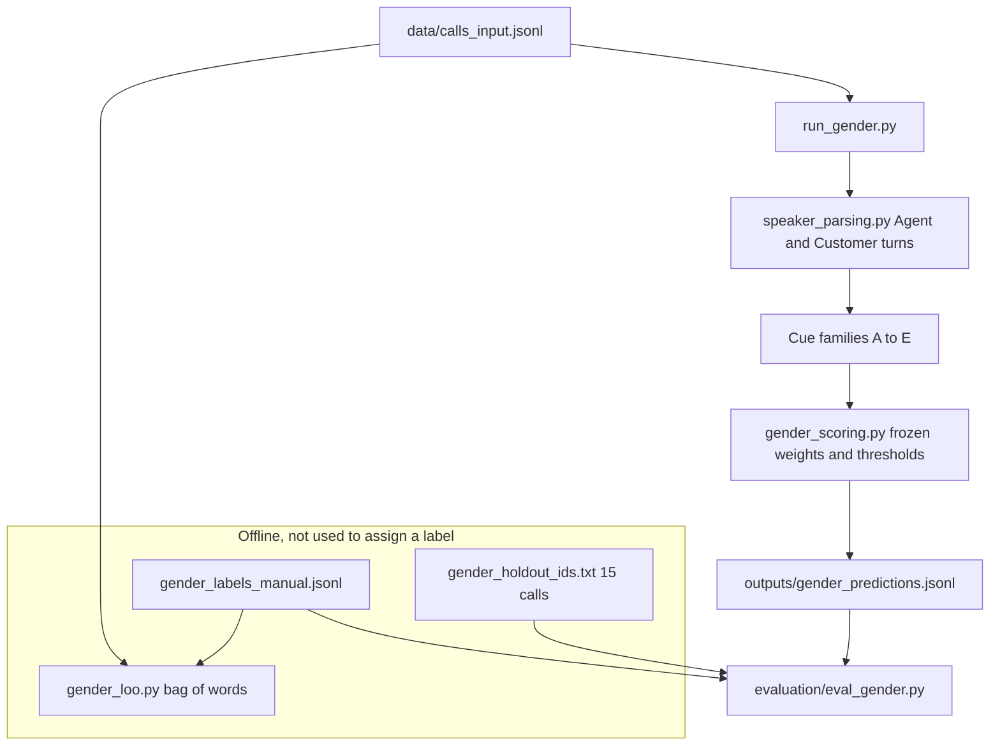
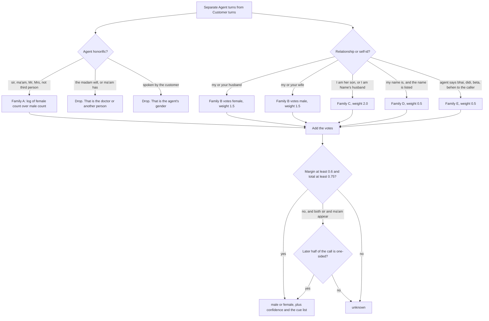

# Task 2 process and design

Label the caller on each of the 50 Aster Vale transcripts. The field is the person marked Customer, not the patient. A caller who says "my mother" can be a son or a daughter. The patient's gender is a different question.

The label is `male`, `female`, or `unknown`. It is inferred from speech cues. `unknown` is a real answer when the cues are thin or point both ways. No transformer and no LLM API is used. `customer_gender/` imports the standard library and the shared JSONL loader. It does not import `openai`, and `requirements.txt` has no `torch`, `transformers`, or `sentence-transformers`.

## Design

One transcript in, one record out: `transcript_id`, `customer_gender`, `confidence`, and `cues`. The cues are the quotes that voted and which family each came from.

The method is a weighted vote of labeling functions. Each family votes male, female, or abstains. That is the same pattern as weak supervision. The weights are written in `gender_scoring.py`. They were chosen from how reliable each cue is, then left alone. A bag-of-words logistic regression is a comparison only. It is not what `run_gender.py` writes.

`run_gender.py` never reads the hand labels. The evaluator does, after the predictions exist.

### What is counted

Turns are split on the `Agent:` and `Customer:` labels. A line with no label continues the previous speaker.

| Family | What counts | What is dropped | Vote |
|---|---|---|---|
| A | Agent says sir, ma'am, madam, Mr, Mrs, Ms, or Miss to the caller | Third person: "the madam will", "ma'am has". Anything the customer says to the agent | log of (female count + 0.5) over (male count + 0.5) |
| B | "my husband" or "your husband" | "my daughter", "my mother" | female, weight 1.5, once |
| B | "my wife" or "your wife" | | male, weight 1.5, once |
| C | "I am her son", "I am Renu's husband", and the matching wife or daughter forms | | weight 2.0, once per side |
| D | Customer says "my name is" and the name is in the list in `cue_lexicons.py` | Names that are not in the list. Names the agent uses for the patient | weight 0.5, once per side |
| E | Agent says bhai, bhaiya, beta, didi, or behen to the caller | "my beta", "the didi" | weight 0.5, once per side |

Family A uses the ratio of counts, so 26 against 0 is strong and 1 against 1 is about zero. Repeating "my husband" does not add the weight again.

### How a vote becomes a label

Confidence is the margin divided by the margin plus one. A single weak name (0.5) stays under 0.75, so it cannot decide a call by itself. One clear "sir", or one "my husband", can.

The constants `WEIGHT_B` 1.5, `WEIGHT_C` 2.0, `WEIGHT_D` 0.5, `WEIGHT_E` 0.5, `MIN_MARGIN` 0.6, and `MIN_TOTAL` 0.75 live at the top of `gender_scoring.py`. Tag `gender-weights-frozen` points at commit `ff50c73589406e60c618c534786474e583faa4b6`, which contains those constants and not this sentence. They were not edited after the scores below were produced.

## What was measured

Hand labels were written by reading the transcripts: 35 male, 14 female, and 1 unclear (AVT-008, where a husband and a wife both take the phone). Those labels use the same address terms and relationship words the rules count. Agreement with them is not an accuracy estimate for other clinics, other languages, or calls that were not read this way.

| Slice | Both sides committed male or female | Rules left unknown | Hand label left unclear |
|---|---|---|---|
| All 50 | 48 of those calls agree | 1 (AVT-039) | 1 (AVT-008) |
| 35 calls that informed the cue list | 33 agree | 1 | 1 |
| 15 calls held out of the cue design | 15 agree | 0 | 0 |

The held-out 15 are in `data/splits/gender_holdout_ids.txt`. None of them had both an honorific and a relationship cue, so that slice does not test whether families agree with each other. On the other 35, family A and families B or C agreed on all 10 calls where both fired. That check does not use the hand label.

The two calls that are not a simple match:

- AVT-008. The hand label is unclear, because both spouses speak. The later half of the call is the husband booking the visit, so the tie-break says male.
- AVT-039. The hand label is male because the caller says his name is Zayan. The agent never says sir or ma'am, and Zayan is not in the name list, so the rules abstain. The name was not added after the fact.

Turning the third-person filter off changes one call. On AVT-015 the agent says sir to the son who is calling about his mother, and also says "the madam will tell you" about the doctor. Without the filter the call is labeled female. With the filter it stays male.

Family A by itself matches the full rule set on every call where both the rules and the hand label committed. The extra families did not overturn an honorific on this sample.

### Comparison, not the submission

`evaluation/gender_loo.py` fits a bag-of-words logistic regression and tests each call with a model trained on the other male and female hand labels. AVT-008 is left out, because one unclear label cannot train a third class. There is no new package: the fit is ordinary gradient descent in that file.

On the 49 male and female hand labels it agrees on 42 (85.7%). Always guessing male agrees on 35 (71.4%). All 7 misses are female callers predicted male. That is what a small, male-heavy set does to a learned model. The rules are what gets submitted, because they abstain instead of guessing and because each vote can be quoted.

## What this does not show

These are 50 translated calls from one clinic. The hand labels and family A look at the same words, so the 48 agreements are a check that the vote implements that reading, not a rate to quote for new calls. The useful separate checks are the 10-of-10 family agreement, the held-out 15, the filter ablation on AVT-015, and the logistic regression sitting below the rules and closer to the male majority.

## Note for Vishal

For task 2 I am labeling the caller marked Customer, not the patient. Caregivers are common in these transcripts, so the patient's gender is a different question. The label is inferred from address terms and relationship words, and I leave it unknown when the evidence is mixed or missing.
